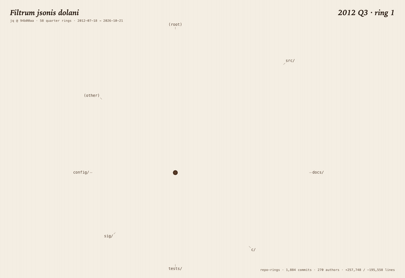
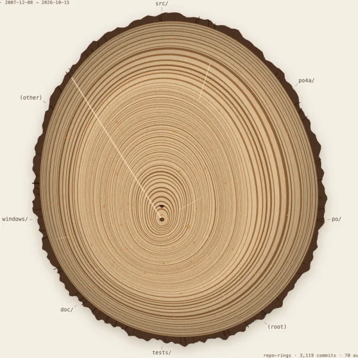
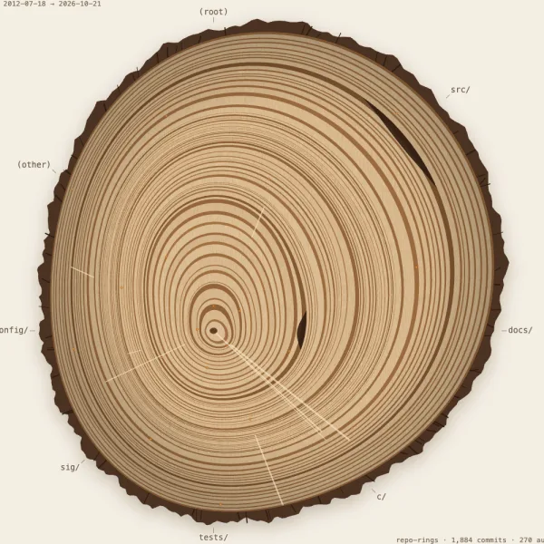
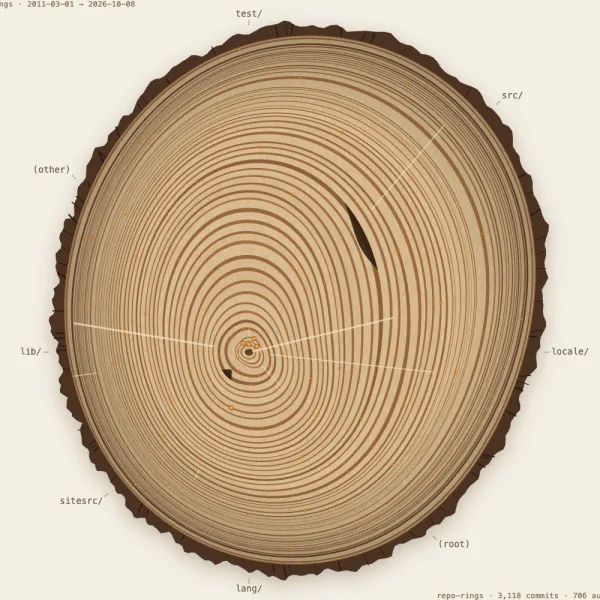
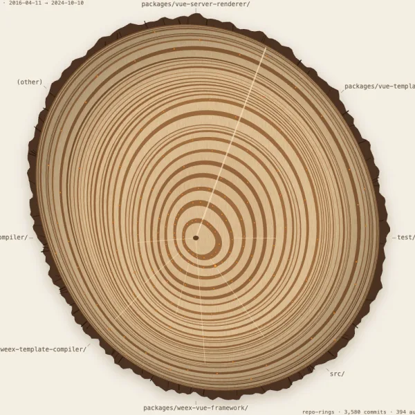
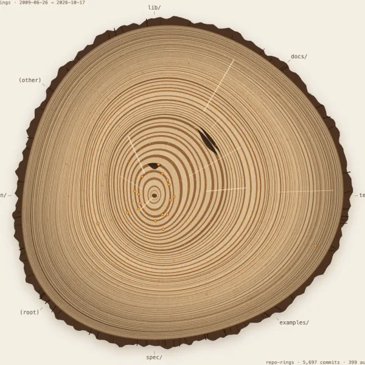
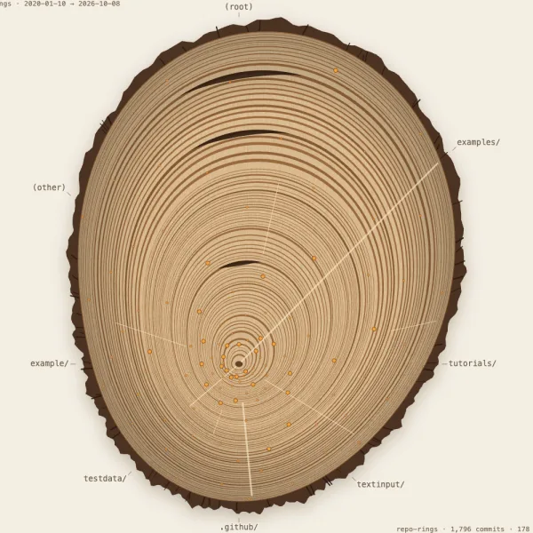

# repo-rings

**Cut any git repository open and read its history like a tree.** The pith is the first commit, the bark is HEAD, and every ring between is a week, month, quarter or year of work. An agent skill: the scripts draw, the agent only writes short field notes, and every note must cite a real tag or commit or the build stops.

<a href="https://majiayu000.github.io/repo-rings/gallery/jq/jq-rings.html"></a>

*jq, 58 quarterly rings. The hairline band in the middle is the five years after jq 1.6; the wide ring after it is jq 1.7 in 2023.*

No API keys, no network, no `npm install`. Works with Claude Code, Codex, Cursor and other agents that read `SKILL.md`. Needs git and [Bun](https://bun.sh).

## Install

```bash
npx skills add majiayu000/repo-rings
```

In Claude Code you can also use the plugin marketplace: `/plugin marketplace add majiayu000/repo-rings`, then `/plugin install repo-rings@repo-rings`.

## Use

Ask your agent:

> Draw the tree rings of this repository.

You get one HTML page that grows the tree from the pith to the bark, with a pause button and a slider, plus an SVG and PNG for your README or a post. Hover any ring to read that period: commits, authors, folders, tags and the largest commits. With an extra step the skill also makes a growth GIF.

## Gallery

**[Open the gallery →](https://majiayu000.github.io/repo-rings/gallery/)**

| | | |
|:-:|:-:|:-:|
| [](https://majiayu000.github.io/repo-rings/gallery/xz/xz-rings.html)<br>**XZ Utils**<br>one long ray, a second one that stops in 2024 Q1, then the backdoor removal | [](https://majiayu000.github.io/repo-rings/gallery/jq/jq-rings.html)<br>**jq**<br>five thin years, then the jqlang revival | [](https://majiayu000.github.io/repo-rings/gallery/moment/moment-rings.html)<br>**Moment.js**<br>ten quiet quarters, then a new ring in 2026 |
| [](https://majiayu000.github.io/repo-rings/gallery/vue/vue-rings.html)<br>**Vue 2**<br>a fresh start in 2016, end of life in 2023 | [](https://majiayu000.github.io/repo-rings/gallery/express/express-rings.html)<br>**Express**<br>v5 alpha in 2014, v5.0.0 thirty-nine rings later | [](https://majiayu000.github.io/repo-rings/gallery/bubbletea/bubbletea-rings.html)<br>**Bubble Tea**<br>an event-loop rewrite cuts the widest ring |

## How to read it

| Mark | Meaning |
| --- | --- |
| Ring | One period. Wider rings had more commits (square-root scaled, merges excluded). |
| Dark outer band of a ring | Share of lines deleted. Pruning periods look dense and dark. |
| Lopsided growth | Each direction around the trunk is one folder, labelled outside the bark. A ring bulges towards the folders that changed most. |
| Thin dark line | A period with no commits. |
| Scar | A period that deleted far more than it added. |
| Resin bead | A tag. Large beads are `x.0.0` or `0.x.0` releases. |
| Pale ray | A top human contributor, from their first ring to their last. |

## How it works

1. `extract.ts` reads `git log --numstat` and tags into `rings.json`. Read-only, no network. It refuses shallow clones, because a cut-off history draws a false pith.
2. `summarize.ts` prints the busiest rings, pruning, quiet stretches, releases and contributors, so the agent can pick 5 to 8 moments worth a note.
3. The agent writes `annotations.json`: a playful Latin name, a short description and the field notes.
4. `render.ts` checks every note against the data (the tag or commit must exist **in that ring**, a "quiet" note needs a ring with two commits or fewer) and only then draws the page.

The full workflow is in [`skills/repo-rings/SKILL.md`](skills/repo-rings/SKILL.md).

## Keep it fresh

[`examples/github-action/`](examples/github-action/) has an optional workflow that re-draws the image in your README on the first of every month, reusing the notes you already checked. It is an example only; copy it into your own repository to use it.

## Develop

```bash
bun test
```

```bash
bun tools/build-gallery.ts
```

The test renders a deliberately wrong `tests/bad-annotations.json` and expects every planted error to be rejected, then checks that every gallery specimen passes. The gallery build re-renders each page from its committed `rings.json` and `annotations.json` (needs Chrome and `cwebp` for thumbnails); [`gallery/README.md`](gallery/README.md) lists how each history was extracted.

## License

MIT
